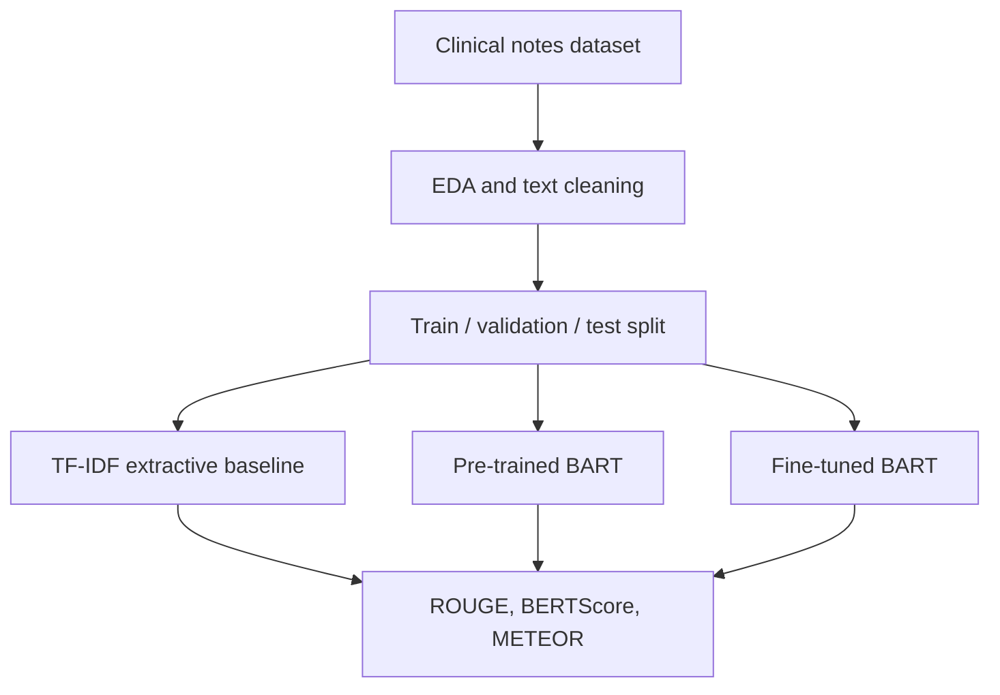

# Medical Record Summarisation

A notebook-based NLP project exploring automatic summarisation of clinical notes. It compares an extractive baseline with pre-trained and fine-tuned BART models.

## Workflow

## Approach
- Load the `AGBonnet/augmented-clinical-notes` dataset
- Explore note lengths and summary compression
- Clean text and create reproducible data splits
- Compare TF-IDF extractive summarisation and `facebook/bart-large-cnn`
- Fine-tune BART and evaluate generated summaries

## Stack
Python · PyTorch · Hugging Face Transformers and Datasets · scikit-learn · NLTK · ROUGE · BERTScore · Matplotlib · Seaborn

## Run
The experiment is provided as a Kaggle-compatible notebook:

`NLP - Medical Record Summarisation/medical record summarisation.ipynb`

Open it in Kaggle or Jupyter and run the cells in order. Internet access is needed to download the dataset and pretrained model; a CUDA-enabled GPU is recommended for fine-tuning.

## Evaluation
The notebook calculates ROUGE-1, ROUGE-2, ROUGE-L, BERTScore, and METEOR for the tested approaches.

## Repository Contents
- Notebook – end-to-end experiment
- `medical_nlp_paper.docx` – project paper

> **Disclaimer:** This is an NLP research project. Generated summaries require clinical review and must not be used as the sole basis for medical decisions.
